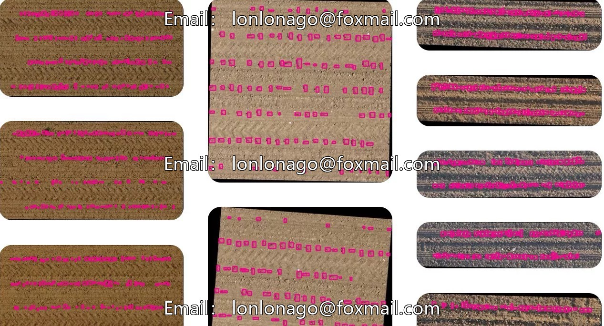
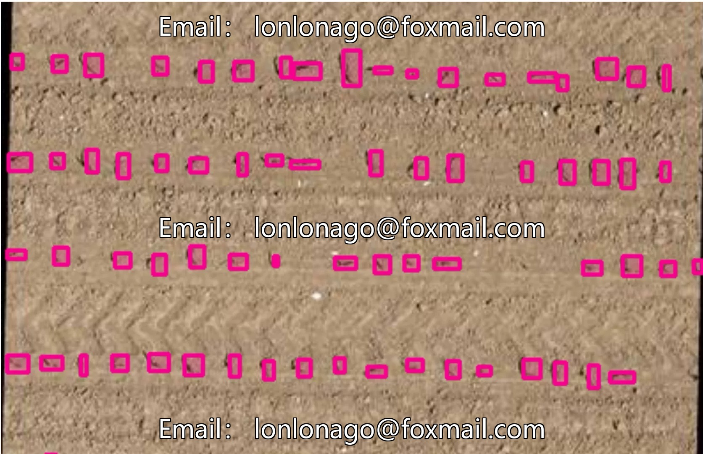
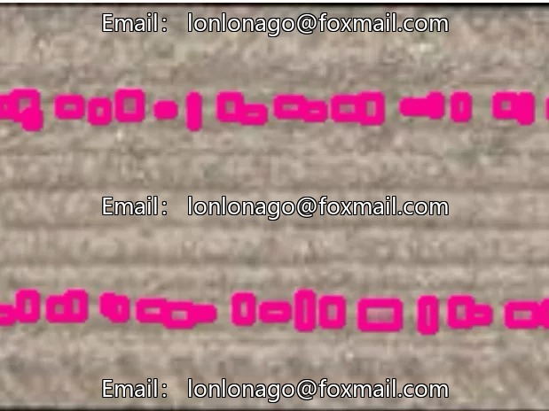
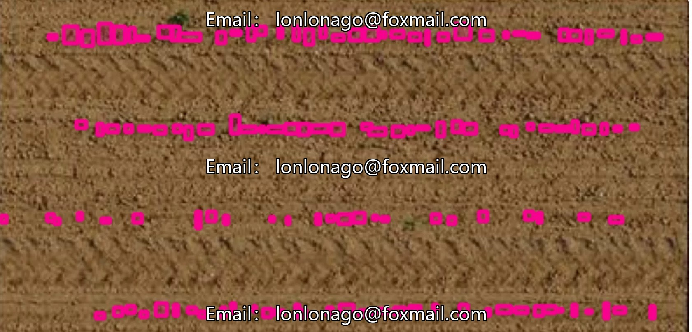

# Intelligent Agriculture Seedling Rate Identification Image Dataset, collected by drone aerial photography, including corn and sunflowers.

## Body

Intelligent Agriculture Seedling Rate Recognition Image Dataset, collected by drone aerial photography, including the recognition of corn, sunflower, and beet seedling rates. The dataset consists of 1030 images, fully labeled with bounding box annotations, and no unlabeled images.

The dataset consists of 189 images, with 16,122 labeled objects. No training, validation, or test sets are divided, making it suitable for agricultural domain object detection tasks and supports model training and research.

Virtual materials, once sold, are non-refundable.
Interested friends, click "I want" to proceed.

## Images

## Payment

Here is a pay link on Stripe ( https://buy.stripe.com/3cs8yP7sY87d0vu9AB ). Please contact me lonlonago@foxmail.com after funding $89, and I will send you a complete data files , thank you!

